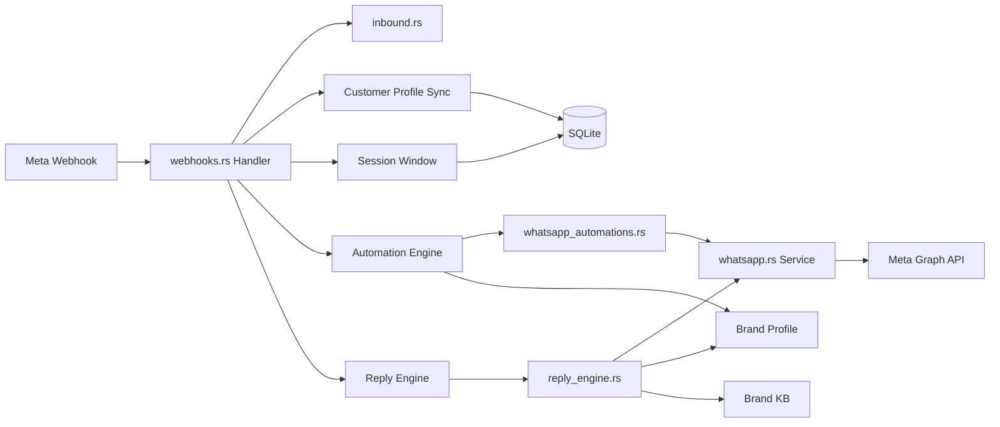

# Execution Plan

### `✓` Step 1: Add Brand, Organization models & database migration
### `✓` Step 2: Build Brand CRUD backend routes
### `✓` Step 3: Build Brand frontend pages and navigation
### `✓` Step 4: Update existing routes and services for brand awareness (each brand has its own reply engine)
### `✓` Step 5: Enhanced profiles - unique IDs, data sources, live sync, conflicts, custom sections
### `✓` Step 6: Redesign navigation - new nav structure, sub-nav, logical grouping
### `✓` Step 7: Create missing pages - ClientProfile, BrandsList
### `✓` Step 8: Update App.tsx routes for new navigation
### `✓` Step 9: Build, deploy, and verify

### `✓` Step 10: WhatsApp Channel - Database migration and models
### `✓` Step 11: WhatsApp Channel - Rich messaging service
### `✓` Step 12: WhatsApp Channel - Automation engine
### `✓` Step 13: WhatsApp Channel - Webhook enhancements and Meta sync routes
### `✓` Step 14: WhatsApp Channel - Frontend page connected to Brand Profile
### `✓` Step 15: Wire WhatsApp webhooks to automation engine, customer sync, and session tracking
### `✓` Step 16: Connect WhatsApp to brand-specific reply engine
### `✓` Step 17: Deploy and verify WhatsApp channel end-to-end

### `✓` Step 18: WhatsApp Campaigns - Database migration and models
### `✓` Step 19: WhatsApp Campaigns - Meta template sync and message limits service
### `✓` Step 20: WhatsApp Campaigns - Template/flow management with industry grouping
### `✓` Step 21: WhatsApp Campaigns - Campaign execution engine with retry
### `✓` Step 22: WhatsApp Campaigns - AI agent integration for campaigns
### `*` Step 23: WhatsApp Campaigns - Frontend page for campaigns and templates (in progress)
### ` ` Step 24: Add industry selection to Brand Profile
### ` ` Step 25: Build and deploy all changes

# WhatsApp Campaigns, Templates, Flows, and Industries — Current Status

## What Is Already Built ✅

| Component | File | Status |
|-----------|------|--------|
| WhatsApp migration | `migrations/0006_whatsapp_channel.sql` | ✅ 7 tables |
| WhatsApp models | `models/mod.rs` | ✅ 7 structs |
| Rich messaging | `services/whatsapp.rs` | ✅ All message types |
| Automation engine | `services/whatsapp_automations.rs` | ✅ 8 automation types |
| Webhook wiring | `routes/webhooks.rs` | ✅ Automation + reply engine |
| Brand-scoped routes | `routes/brands.rs` | ✅ 11 WhatsApp endpoints |
| Frontend page | `WhatsAppIntegration.tsx` | ✅ 5 tabs |

## What Needs to Be Built ❌

### 1. Campaign Execution Engine
- No brand-scoped campaign creation, contact selection, sending, or retry
- `broadcasts.rs` exists but is tenant-scoped, not brand-scoped
- No message limit tracking before sending

### 2. Template/Flow Management
- No industry-specific template grouping
- No multi-step flow editor
- No template duplication or validation

### 3. Meta Template Sync
- Templates are not synced from Meta Graph API
- No message limit tracking from Meta

### 4. AI Campaign Integration
- AI cannot suggest or launch campaigns
- AI cannot generate campaign content
- Post-campaign replies not linked to campaign context

### 5. Frontend Campaign Page
- No campaign creation wizard
- No template/flow editor
- No industry selection in brand profile

## Implementation Plan

### Step 18: Database Migration
- Create `0007_whatsapp_campaigns_flows.sql` with all new tables
- Add Rust structs for all new models

### Step 19: Meta Template Sync Service
- Create `services/whatsapp_template_sync.rs`
- Sync templates from Meta, track message limits

### Step 20: Template/Flow Management
- Create `services/whatsapp_flows.rs`
- Industry CRUD, template group CRUD, flow CRUD with steps

### Step 21: Campaign Execution Engine
- Create `services/whatsapp_campaigns.rs`
- Campaign creation, contact selection, sending, retry

### Step 22: AI Integration
- Update `services/reply_engine.rs` for campaign context
- Add AI campaign suggestion and content generation

### Step 23: Frontend Page
- Create `WhatsAppCampaigns.tsx` with 7 tabs
- Template/flow editor, campaign wizard, analytics

### Step 24: Brand Profile Industry
- Add industry field to Brand Profile
- Update migration and models

### Step 25: Build and Deploy
- Build backend and frontend
- Deploy to https://communicator.newax.co

# WhatsApp Channel — Current Status and Remaining Work

## What Is Already Built ✅

| Component | File | Status |
|-----------|------|--------|
| Database migration | `migrations/0006_whatsapp_channel.sql` | ✅ All 7 tables created |
| Rust models | `models/mod.rs` | ✅ All 7 WhatsApp structs |
| Rich messaging service | `services/whatsapp.rs` (876 lines) | ✅ All message types |
| Automation engine | `services/whatsapp_automations.rs` (703 lines) | ✅ All 8 automation types |
| Brand-scoped routes | `routes/brands.rs` | ✅ 11 WhatsApp endpoints |
| Frontend page | `WhatsAppIntegration.tsx` (1007 lines) | ✅ 5 tabs, brand-aware |
| API methods | `api.ts` | ✅ All WhatsApp methods |

## What Is Missing ❌

### 1. Webhook → Automation Engine Connection
The `meta_whatsapp_inbound` handler in `webhooks.rs` processes messages through `inbound::process_inbound_message()` but **never calls**:
- `WhatsAppAutomationEngine.handle_agent_commands()` — for #bot, #resolve, #csat, #tag
- `WhatsAppAutomationEngine.handle_csat_response()` — for CSAT ratings
- `WhatsAppAutomationEngine.handle_navigation_menu()` — for menu navigation
- `WhatsAppAutomationEngine.match_advanced_rule()` — for automation rules
- `WhatsAppAutomationEngine.send_welcome_greeting()` — for first-touch greetings
- `WhatsAppService.update_session_window()` — for 24h session tracking
- `WhatsAppAutomationEngine.sync_customer_profile_from_meta()` — for customer data

### 2. Interactive Message Parsing
Meta webhooks send interactive responses (button clicks, list selections, reactions, location shares) but these are not parsed. Only `extract_meta_message_text()` is called.

### 3. Customer Profile Sync
Meta webhook payloads contain customer profile data (name, picture, about) in the `contacts` array. This data is stored in a local `contacts_map` but never persisted to `whatsapp_customer_profiles`.

### 4. Session Window Tracking
No 24h session window is created or updated when messages arrive.

### 5. Reply Engine Connection
No connection between WhatsApp inbound messages and the brand-specific reply engine for AI-generated responses.

## Remaining Work

### Step 15: Wire WhatsApp Webhooks
- Update `routes/webhooks.rs` `meta_whatsapp_inbound` to:
  1. Parse interactive messages (buttons, lists, reactions, location)
  2. Sync customer profiles from Meta contacts array to `whatsapp_customer_profiles`
  3. Update/create session windows in `whatsapp_session_windows`
  4. Call automation engine for agent commands, CSAT, menus, rules
  5. Send welcome greeting if first touch
  6. Mark as read if auto_read_receipts is enabled

### Step 16: Connect to Reply Engine
- Wire WhatsApp inbound messages to the brand-specific reply engine
- Reply engine reads brand profile + org profile + brand KB for context
- Auto-reply with AI-generated responses based on brand configuration


# Technical Design — WhatsApp Webhook Wiring

### Current Webhook Flow
```
Meta Webhook → webhooks.rs::meta_whatsapp_inbound
  → extract_meta_message_text() (only text extracted)
  → inbound::process_inbound_message() (stores in DB)
  → returns OK
```

### New Webhook Flow
```
Meta Webhook → webhooks.rs::meta_whatsapp_inbound
  → parse interactive messages (buttons, lists, reactions, location)
  → sync customer profile from contacts array → whatsapp_customer_profiles
  → update session window → whatsapp_session_windows
  → resolve brand_id from conversation/inbox
  → call WhatsAppAutomationEngine:
      - handle_agent_commands() → #bot, #resolve, #csat, #tag
      - handle_csat_response() → CSAT ratings
      - handle_navigation_menu() → menu navigation
      - match_advanced_rule() → automation rules
      - send_welcome_greeting() → first-touch
  → mark as read if auto_read_receipts enabled
  → call brand-specific reply engine for AI auto-reply
```

### Implementation Details

**Step 15: Wire Webhooks (`routes/webhooks.rs`)**
- Add helper function `parse_whatsapp_interactive()` to extract button clicks, list selections, reactions, location from Meta payloads
- After `inbound::process_inbound_message()` succeeds:
  1. Sync customer profile: call `WhatsAppAutomationEngine.sync_customer_profile_from_meta()` with data from contacts array
  2. Update session window: call `WhatsAppService.update_session_window()`
  3. Resolve brand_id: query `inboxes` table for the inbox associated with this conversation, then get `brand_id`
  4. If brand_id found, create automation engine and service instances
  5. Call automation engine methods in order: agent commands → CSAT → menu → rules → welcome greeting
  6. Mark as read if enabled

**Step 16: Reply Engine Connection**
- After automation engine runs, if no automation response was generated:
  1. Call `reply_engine.rs` with brand context
  2. Reply engine assembles: brand profile + org profile + brand KB + conversation history + customer profile
  3. Generate AI response using brand-specific AI config
  4. Send via `WhatsAppService.send_text()` or `send_interactive_buttons()`

### Architecture Diagram



### Risks
- **Brand resolution**: If the conversation has no brand_id yet, fall back to checking the inbox's brand_id. If still none, skip automation and reply engine.
- **Automation order**: Agent commands must be checked first (highest priority), then CSAT, then menu, then rules, then welcome greeting.
- **Reply engine cost**: AI calls are expensive. Only call the reply engine if no automation rule matched and auto-reply is enabled for the brand.
