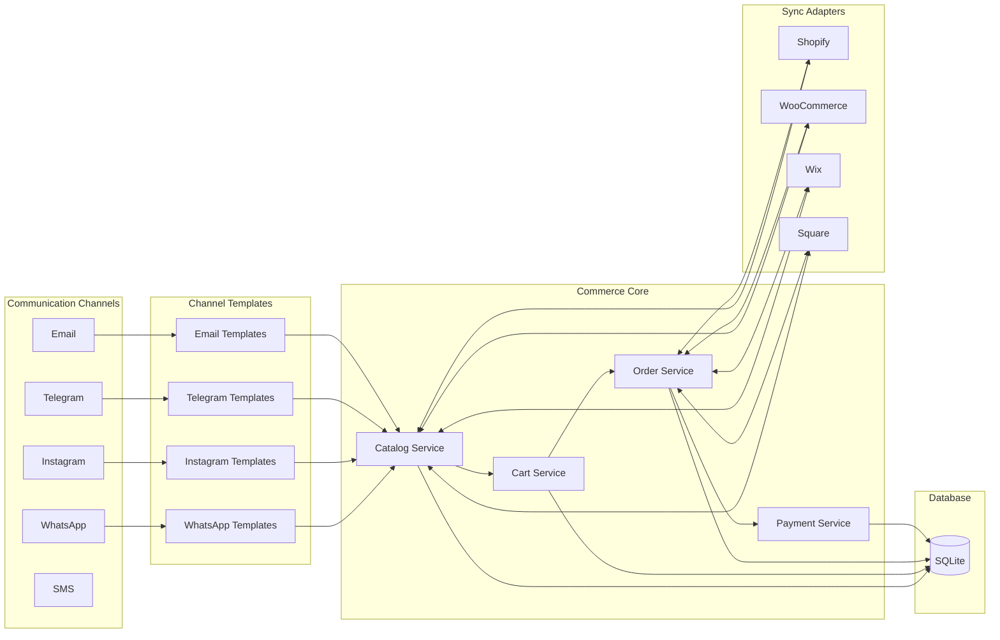

# Requirements

### Overview & Goals
Build an e-commerce engine (product catalog, shopping cart, order history, payments) that works as a **standalone sales channel** and can optionally **sync bidirectionally** with external e-commerce platforms (Shopify, WooCommerce, Wix, Square). The system follows a **channel-first** approach: each communication channel (WhatsApp, Instagram, Telegram, Email, etc.) has its own templates and flows for browsing, carting, and ordering — but all channels share the same underlying catalog, cart, and order data.

### User Stories
- As a merchant, I want to manage a product catalog (products, categories, variants, inventory, pricing) so customers can browse and buy from any channel.
- As a customer, I want to browse products, add items to my cart, and place orders via WhatsApp (or any connected channel).
- As a merchant, I want to sync my catalog and orders with Shopify/WooCommerce/Wix/Square so I don't have to maintain data in two places.
- As a merchant, I want to sell directly through the communication channels without requiring any external platform.
- As a customer, I want to view my order history and track order status.
- As a merchant, I want to accept payments (Stripe, bank transfer, cash on delivery) and track payment status.

### Scope

**In Scope (Phase 1)**
- Product catalog: products, categories, variants, inventory, pricing, images
- Shopping cart: add/remove items, quantities, saved carts
- Order management: create orders, order status tracking, order history
- Payment tracking: payment status, methods, integration with existing Stripe routes
- Channel-specific templates: WhatsApp catalog flows, Instagram product carousels, etc.
- E-commerce platform sync adapters: Shopify, WooCommerce, Wix, Square (bidirectional)
- Frontend pages: catalog management, cart view, order history, sync settings

**Out of Scope (Phase 2+)**
- Delivery tracking and logistics
- Advanced inventory (back-in-stock notifications, multi-warehouse)
- Storefront/link-in-bio builder
- Discounts, coupons, memberships
- Analytics and SEO

### Functional Requirements
- **Catalog**: CRUD for products with name, description, price, currency, images, categories, variants (size, color, etc.), SKU, inventory count, visibility per channel.
- **Cart**: Per-customer cart, add/remove/update quantities, saved carts for returning customers, cart-to-order conversion.
- **Orders**: Order creation from cart, order numbers, status lifecycle (draft → pending → confirmed → processing → shipped → delivered → cancelled), payment status, items snapshot at order time.
- **Payments**: Track payment status (pending, paid, partially_paid, refunded), support multiple methods (Stripe, bank transfer, COD), integrate with existing Stripe routes.
- **Sync**: Bidirectional sync of products, inventory, and orders with external platforms; conflict resolution with our system as primary source; sync is optional — system works fully without it.
- **Channel Templates**: Each channel renders catalog/browse/cart/order flows using channel-specific templates (WhatsApp catalog messages, Instagram product cards, etc.).

### Non-Functional Requirements
- Sync must be optional: all commerce features work without any external platform connected.
- Sync should not block the main flow: if sync fails, the order is still created locally.
- SQLite storage (consistent with existing codebase).
- Rust backend (Axum) + React/TypeScript frontend (existing stack).

# Technical Design

### Current Implementation
The codebase is a multi-channel communication platform:
- **Backend**: Rust/Axum (`backend-rs/`), SQLite via sqlx, migrations in `backend-rs/migrations/`.
- **Existing models** (`models/mod.rs`): `ChannelType` enum (WhatsApp, Email, SMS, Instagram, etc.), `Customer` with `total_orders`/`total_spent` fields, `ClientOrder`/`ClientInvoice`/`ClientPaymentDetail` for client profiles, `IntegrationSettings` for WhatsApp/Meta config.
- **Existing routes**: `brands.rs` (brand management), `client_profiles.rs` (orders, invoices, payments), `whatsapp_flows.rs` (template flows, industries, campaigns), `integrations_parity.rs` (tracker integrations: Linear, GitHub, Jira, Slack), `gateways_webhooks_stripe.rs` (Stripe webhooks).
- **Existing services**: `channels.rs` (outbound channel adapters), `whatsapp_flows.rs` (WhatsApp template/flow service), `whatsapp_campaigns.rs`, `messaging.rs`.
- **Frontend**: React/TypeScript (`frontend/`), pages for brands, client profiles, WhatsApp campaigns, integrations, etc.
- **Migrations**: 7 existing migrations, latest is `0007_whatsapp_campaigns_flows.sql`.

### Key Decisions
1. **Channel-first with shared catalog**: Each channel has its own flow/templates, but all reference a shared `products`/`categories`/`carts`/`orders` core. This matches the user's choice and leverages the existing `ChannelType` enum and channel adapter pattern in `channels.rs`.
2. **Our system as primary source of truth**: In sync conflicts, our data wins. External platforms are mirrors.
3. **Sync adapters as pluggable services**: Each platform (Shopify, WooCommerce, etc.) gets its own service module, following the pattern of `whatsapp_flows.rs` and `channels.rs`.
4. **Orders extend existing `ClientOrder`**: The existing `ClientOrder` model in `models/mod.rs` already has the right shape. We'll add a new `orders` table for the commerce engine and keep `client_orders` for the client profile view.
5. **SQLite only**: Consistent with existing `db/mod.rs` and all migrations.

### Proposed Changes

#### 1. Database Schema (Migration `0008_commerce_engine.sql`)
New tables:
- `categories` — product categories (id, brand_id, name, parent_id, sort_order, is_active)
- `products` — product catalog (id, brand_id, category_id, name, description, sku, price, compare_at_price, currency, images JSON, variants JSON, inventory_count, track_inventory, visibility JSON, metadata, is_active, created_at, updated_at)
- `product_channel_visibility` — which products appear on which channels (product_id, channel_type, is_visible)
- `carts` — shopping carts (id, customer_id, brand_id, channel_type, status, metadata, created_at, updated_at)
- `cart_items` — cart line items (id, cart_id, product_id, variant_id, quantity, unit_price, metadata, created_at)
- `commerce_orders` — orders (id, brand_id, customer_id, order_number, channel_type, status, total_amount, subtotal, tax, shipping, currency, items_snapshot JSON, shipping_address JSON, payment_status, payment_method, metadata, source, external_order_id, created_at, updated_at)
- `commerce_order_items` — order line items (id, order_id, product_id, variant_id, product_name, sku, quantity, unit_price, total_price, metadata)
- `commerce_payments` — payment records (id, order_id, amount, currency, method, status, transaction_id, metadata, created_at)
- `sync_connections` — external platform connections (id, brand_id, platform, credentials JSON, sync_status, last_sync_at, metadata, created_at, updated_at)
- `sync_logs` — sync audit log (id, connection_id, direction, entity_type, entity_id, status, error, created_at)

#### 2. Backend Models (`models/mod.rs`)
New structs: `Category`, `Product`, `ProductVariant`, `Cart`, `CartItem`, `CommerceOrder`, `CommerceOrderItem`, `CommercePayment`, `SyncConnection`, `SyncLog`, plus enums for `OrderStatus`, `PaymentStatus`, `SyncDirection`, `SyncPlatform`.

#### 3. Backend Routes (`routes/commerce.rs`)
- `GET/POST /commerce/categories` — category CRUD
- `GET/POST /commerce/products` — product CRUD
- `GET/PUT/DELETE /commerce/products/{id}` — product details
- `GET/POST /commerce/carts` — cart management
- `GET/PUT /commerce/carts/{id}/items` — cart item operations
- `POST /commerce/carts/{id}/checkout` — cart to order conversion
- `GET /commerce/orders` — order list
- `GET /commerce/orders/{id}` — order details
- `POST /commerce/orders/{id}/update-status` — order status updates
- `GET /commerce/payments` — payment list
- `GET/POST /commerce/sync/connections` — sync connection management
- `POST /commerce/sync/connections/{id}/sync` — trigger sync
- `GET /commerce/sync/logs` — sync audit log

#### 4. Backend Services
- `services/commerce_catalog.rs` — catalog service (product/category CRUD, inventory management, visibility)
- `services/commerce_cart.rs` — cart service (add/remove items, quantities, checkout)
- `services/commerce_orders.rs` — order service (create from cart, status transitions, order history)
- `services/commerce_payments.rs` — payment service (record payments, track status, Stripe integration)
- `services/sync_adapter.rs` — trait definition for sync adapters
- `services/sync_shopify.rs` — Shopify sync adapter (products, inventory, orders bidirectional)
- `services/sync_woocommerce.rs` — WooCommerce sync adapter
- `services/sync_wix.rs` — Wix sync adapter
- `services/sync_square.rs` — Square sync adapter

#### 5. Channel Templates (`services/channel_commerce_templates.rs`)
- WhatsApp: catalog messages, product cards, cart summary, order confirmation (extends `whatsapp_flows.rs`)
- Instagram: product carousels, DM cart flows
- Telegram: inline keyboard catalog, cart buttons
- Email: HTML catalog emails, order confirmations
- Each channel renders the same data differently

#### 6. Frontend Pages
- `CommerceDashboard.tsx` — overview with KPIs (revenue, orders, products)
- `CatalogManagement.tsx` — product and category CRUD
- `ProductDetail.tsx` — single product edit view
- `CartManagement.tsx` — view active carts, merge/convert
- `OrdersList.tsx` — order list with filtering, status updates
- `OrderDetail.tsx` — order details, items, payments, timeline
- `SyncSettings.tsx` — connect/manage external platforms, trigger sync, view logs

#### 7. Route Registration (`main.rs`)
Register all `/commerce/*` routes in the API router.

### Architecture Diagram

### Risks
- **Sync conflicts**: Bidirectional sync can create conflicts. Mitigation: our system is primary source; external changes are merged with ours winning on conflicts.
- **Inventory accuracy**: If inventory changes on both sides simultaneously. Mitigation: timestamp-based last-write-wins with our system preferred; sync logs for audit.
- **Platform API rate limits**: Shopify/WooCommerce have rate limits. Mitigation: queue-based sync with backoff, visible sync status in UI.
- **WhatsApp catalog limitations**: WhatsApp has its own catalog format. Mitigation: channel templates translate our products to WhatsApp catalog format when needed.

# Testing

### Validation Approach
Validate each layer independently: database schema, backend services, routes, and frontend pages.

### Key Scenarios
- **Catalog CRUD**: Create a product with variants, assign to a category, set channel visibility, verify it appears on the correct channels.
- **Cart flow**: Add items to cart, update quantities, remove items, checkout to create an order.
- **Order lifecycle**: Create order from cart → verify order number, status transitions (pending → confirmed → shipped → delivered), order history.
- **Payment tracking**: Record a payment against an order, verify payment status updates.
- **Sync — products outbound**: Create a product in our system, trigger Shopify sync, verify it appears on Shopify.
- **Sync — orders inbound**: Place an order on Shopify, trigger sync, verify it appears in our order list.
- **Solo mode**: Verify all commerce features work without any sync connection configured.
- **Channel templates**: Verify WhatsApp catalog message renders correctly for a product, Instagram carousel shows products.

### Edge Cases
- Cart checkout with zero inventory (should allow or block based on `track_inventory` setting).
- Sync failure during order creation (order should still be created locally).
- Product deleted while in cart (cart item should handle gracefully).
- Concurrent sync from multiple platforms (conflict resolution).
- Currency mismatch between our system and external platform.
- Empty cart checkout attempt.
- Order status rollback (e.g., delivered → cancelled).

### Test Changes
- Add integration tests for commerce routes in `backend-rs/`.
- Add unit tests for cart service (quantity calculations, checkout).
- Add unit tests for sync adapters (mock external API responses).

# Delivery Steps

### ✓ Step 1: Database schema and backend models
Create the commerce engine database schema and all Rust model structs.
- Add migration `0008_commerce_engine.sql` with tables: `categories`, `products`, `product_channel_visibility`, `carts`, `cart_items`, `commerce_orders`, `commerce_order_items`, `commerce_payments`, `sync_connections`, `sync_logs`.
- Add model structs to `models/mod.rs`: `Category`, `Product`, `ProductVariant`, `Cart`, `CartItem`, `CommerceOrder`, `CommerceOrderItem`, `CommercePayment`, `SyncConnection`, `SyncLog`, plus enums `OrderStatus`, `PaymentStatus`, `SyncDirection`, `SyncPlatform`.
- Seed default categories and sample data patterns consistent with existing migrations.

### ✓ Step 2: Catalog and Cart services with routes
Implement the product catalog and shopping cart backend services and API routes.
- Create `services/commerce_catalog.rs`: category CRUD, product CRUD, variant management, inventory tracking, channel visibility.
- Create `services/commerce_cart.rs`: cart creation, add/remove/update items, quantity validation, cart status (active, saved, converted).
- Create `routes/commerce.rs`: `/commerce/categories`, `/commerce/products`, `/commerce/carts`, `/commerce/carts/{id}/items` endpoints.
- Register routes in `main.rs` under the API router.
- Wire the `CommerceCatalogService` and `CommerceCartService` into `AppState`.

### ✓ Step 3: Orders, Payments services with routes
Implement order management and payment tracking backend services and API routes.
- Create `services/commerce_orders.rs`: create order from cart (with item snapshot), order status transitions, order history queries, order number generation.
- Create `services/commerce_payments.rs`: record payments, track payment status, link payments to orders, integrate with existing Stripe webhook routes.
- Extend `routes/commerce.rs`: `/commerce/carts/{id}/checkout`, `/commerce/orders`, `/commerce/orders/{id}`, `/commerce/payments` endpoints.
- Order status lifecycle: draft → pending → confirmed → processing → shipped → delivered → cancelled.

### ✓ Step 4: Sync adapter framework and platform adapters
Build the sync adapter system and implement adapters for Shopify, WooCommerce, Wix, and Square.
- Create `services/sync_adapter.rs`: define `SyncAdapter` trait with methods for sync products, sync orders, sync inventory, and bidirectional sync orchestration.
- Create `services/sync_shopify.rs`: Shopify REST/GraphQL API integration for products, inventory, orders (bidirectional).
- Create `services/sync_woocommerce.rs`: WooCommerce REST API integration.
- Create `services/sync_wix.rs`: Wix Velo/Coral API integration.
- Create `services/sync_square.rs`: Square Catalog and Orders API integration.
- Create sync connection management: `/commerce/sync/connections`, `/commerce/sync/connections/{id}/sync`, `/commerce/sync/logs`.
- Sync conflict resolution: our system is primary source; external changes merge with ours winning.

### ✓ Step 5: Channel commerce templates
Create channel-specific templates for catalog browsing, cart, and order flows.
- Create `services/channel_commerce_templates.rs`: template rendering for each channel type.
- WhatsApp: catalog product cards, cart summary messages, order confirmation templates (extends `whatsapp_flows.rs` pattern).
- Instagram: product carousel templates, DM cart flows.
- Telegram: inline keyboard catalog navigation, cart buttons.
- Email: HTML catalog emails, order confirmation emails.
- Each template renders the same commerce data but in channel-appropriate format.
- Integrate with existing `whatsapp_template_flows` for WhatsApp-specific template management.

### ✓ Step 6: Frontend commerce pages and navigation
Build the frontend pages for commerce management and wire them into the navigation.
- Create `CommerceDashboard.tsx`: KPI overview (revenue, orders count, products count, recent orders).
- Create `CatalogManagement.tsx`: product and category list, CRUD operations, inventory management, links to ProductDetail.
- Create `ProductDetail.tsx`: single product edit view with variants, images, pricing, channel visibility.
- Create `CartManagement.tsx`: view active/saved carts, add/remove items, quantity controls, checkout to order.
- Create `OrdersList.tsx`: order list with filtering by status, date, channel; status update actions; links to OrderDetail.
- Create `OrderDetail.tsx`: order details, items, payments, timeline, customer info, status update.
- Create `SyncSettings.tsx`: connect/manage external platforms, trigger sync, view sync logs.
- Update `navSections.ts` to add commerce navigation section with Carts link.
- Update `App.tsx` to register all routes including `/commerce/catalog/:id`, `/commerce/carts`, `/commerce/orders/:id`.
- Add API client functions in `lib/api.ts` for all commerce endpoints including cart and product detail operations.

### ✓ Step 4b: Full sync adapter implementation & integration
Complete the bidirectional sync integration that was partially stubbed in Step 4.
- **Database migration `0015_sync_mapping.sql`** — `external_product_mapping`, `external_order_mapping`, `sync_queue`, `webhook_events` tables.
- **Full Shopify adapter** (`sync_shopify.rs`, 988 lines) — products, orders, inventory bidirectional sync with Shopify REST API.
- **Full WooCommerce adapter** (`sync_woocommerce.rs`, 925 lines) — products, orders, inventory bidirectional sync with WooCommerce REST API v3.
- **Full Wix adapter** (`sync_wix.rs`, 805 lines) — products, orders, inventory sync using Wix Headless Commerce GraphQL API.
- **Full Square adapter** (`sync_square.rs`, 770 lines) — products, orders, inventory sync using Square Catalog and Orders API.
- **Multi-platform sync orchestrator** — `sync_all_platforms()`, `get_platform_info()`, `list_product_mappings()`, `process_sync_queue()`, auto-sync hooks.
- **Auto-sync hooks** in `routes/commerce.rs` — product/order changes auto-queue sync to all platforms.
- **Webhook endpoints** — Shopify and WooCommerce webhooks for real-time updates.
- **Enhanced SyncSettings frontend** — "How Sync Works" guide, product mappings view, sync queue, platform-specific credentials.
- **cargo check** — sync code compiles cleanly; 148 pre-existing errors in unrelated files.

### ✓ Step 4c: Sync system completion — missing routes & webhook integration
Cross-checked all sync requirements and filled in the gaps between frontend expectations and backend implementation.
- **Added missing route handlers** in `routes/commerce.rs`: `sync_all_platforms`, `get_platform_info`, `list_product_mappings`, `process_sync_queue` — these service methods existed but had no API endpoints.
- **Added webhook route handlers** in `routes/commerce.rs`: `webhook_shopify` (POST /commerce/webhooks/shopify), `webhook_woocommerce` (POST /commerce/webhooks/woocommerce) — store events and process asynchronously.
- **Added `process_webhook()` method** in `sync_adapter.rs` — parses webhook events, dispatches to appropriate adapter for inbound sync, marks events as processed.
- **Added `list_connections_all()` method** in `sync_adapter.rs` — lists all connections across brands for webhook processing.
- **Added `create_adapter_for_platform()` helper** in `sync_adapter.rs` — factory function for creating the correct adapter by platform type.
- **Registered all new routes** in `main.rs`: `/commerce/sync/all`, `/commerce/sync/connections/{id}/info`, `/commerce/sync/connections/{id}/mappings`, `/commerce/sync/queue/process`, `/commerce/webhooks/shopify`, `/commerce/webhooks/woocommerce`.
- **Verified frontend API functions** in `lib/api.ts` — `syncAllPlatforms`, `getPlatformInfo`, `listProductMappings`, `processSyncQueue` all match backend endpoints.
- **Verified SyncSettings.tsx** — "Sync All" button, product mappings view, sync queue processing, and sync logs all connected.
- **cargo check** — all sync code compiles with zero errors and zero warnings.

---

# Phase 2: Advanced Commerce Features

### Overview
Phase 2 adds the advanced commerce capabilities that were marked as out of scope in Phase 1: discounts & coupons, analytics dashboard, delivery tracking, storefront builder, and advanced inventory management.

### Delivery Steps

✓ Step 7: Discounts, Coupons & Promotions
Add coupon codes, percentage/fixed discounts, membership pricing, and promotional campaigns.
- Add migration `0009_discounts.sql` with tables: `coupons` (id, brand_id, code, type, value, min_order_amount, max_discount, usage_limit, used_count, starts_at, ends_at, applicable_products JSON, applicable_categories JSON, is_active), `coupon_usage` (id, coupon_id, order_id, customer_id, discount_amount, used_at), `membership_tiers` (id, brand_id, name, discount_percent, monthly_price, benefits JSON, is_active), `customer_memberships` (id, customer_id, membership_tier_id, started_at, ends_at, status).
- Add model structs to `models/mod.rs`: `Coupon`, `CouponUsage`, `MembershipTier`, `CustomerMembership`.
- Create `services/commerce_discounts.rs`: coupon CRUD, validate coupon, calculate discount, apply to cart/order, usage tracking, membership tier management.
- Extend `routes/commerce.rs`: `/commerce/coupons`, `/commerce/coupons/{id}`, `/commerce/coupons/validate`, `/commerce/memberships`, `/commerce/memberships/{id}`.
- Update `services/commerce_cart.rs`: apply coupon discount to cart total.
- Update `services/commerce_orders.rs`: apply coupon at checkout, record coupon usage.
- Create frontend `CouponsManagement.tsx`: coupon CRUD, usage stats, validate coupon codes.
- Create frontend `MembershipsPage.tsx`: membership tier management, customer memberships.
- Update `CartManagement.tsx`: add coupon code input and discount display.
- Update `lib/api.ts`: add API functions for coupons and memberships.
- Update `App.tsx` and `navSections.ts`: add Coupons and Memberships routes.

✓ Step 8: Analytics Dashboard & SEO
Build revenue charts, order trends, top products, customer insights, and SEO basics.
- Add migration `0010_analytics.sql` with tables: `analytics_daily_stats` (id, brand_id, date, orders_count, revenue, avg_order_value, unique_customers, products_sold), `analytics_events` (id, brand_id, event_type, entity_type, entity_id, properties JSON, created_at).
- Add model structs to `models/mod.rs`: `AnalyticsDailyStat`, `AnalyticsEvent`.
- Create `services/commerce_analytics.rs`: calculate daily stats, revenue trends, top products, top customers, order status distribution, channel performance, SEO meta data generation.
- Extend `routes/commerce.rs`: `/commerce/analytics/overview`, `/commerce/analytics/revenue`, `/commerce/analytics/top-products`, `/commerce/analytics/top-customers`, `/commerce/analytics/channels`, `/commerce/analytics/seo-meta`.
- Create frontend `AnalyticsDashboard.tsx`: revenue chart (line), orders chart (bar), top products table, top customers table, channel breakdown, KPI cards.
- Enhance `CommerceDashboard.tsx`: integrate analytics KPIs and recent trends.
- Update `lib/api.ts`: add API functions for analytics endpoints.
- Update `App.tsx` and `navSections.ts`: add Analytics route.

✓ Step 9: Delivery Tracking & Shipping
Add shipping methods, tracking numbers, delivery status updates, and logistics integration.
- Add migration `0011_delivery.sql` with tables: `shipping_methods` (id, brand_id, name, type, rate, free_shipping_threshold, regions JSON, is_active), `shipments` (id, order_id, tracking_number, carrier, status, estimated_delivery, actual_delivery, shipping_label_url, created_at, updated_at), `delivery_events` (id, shipment_id, event_type, location, description, timestamp).
- Add model structs to `models/mod.rs`: `ShippingMethod`, `Shipment`, `DeliveryEvent`, plus enums `ShipmentStatus`, `DeliveryEventType`.
- Create `services/commerce_delivery.rs`: shipping method CRUD, create shipment from order, update tracking, delivery event tracking, carrier integration stubs.
- Extend `routes/commerce.rs`: `/commerce/shipping-methods`, `/commerce/shipping-methods/{id}`, `/commerce/shipments`, `/commerce/shipments/{id}`, `/commerce/shipments/{id}/tracking`, `/commerce/shipments/{id}/events`.
- Update `services/commerce_orders.rs`: link shipment to order, update order status on shipment events.
- Create frontend `ShippingSettings.tsx`: shipping methods CRUD, rate configuration.
- Create frontend `ShipmentDetail.tsx`: tracking timeline, delivery events, carrier info.
- Update `OrderDetail.tsx`: add shipment tracking section.
- Update `lib/api.ts`: add API functions for shipping and shipments.
- Update `App.tsx` and `navSections.ts`: add Shipping and Shipment routes.

✓ Step 10: Storefront / Link-in-Bio Builder
Create a public-facing product storefront page that customers can browse without any chat channel.
- Add migration `0012_storefront.sql` with tables: `storefronts` (id, brand_id, slug, title, description, theme JSON, hero_image, seo_title, seo_description, is_active, created_at, updated_at), `storefront_sections` (id, storefront_id, section_type, sort_order, content JSON), `storefront_visits` (id, storefront_id, visitor_ip, user_agent, path, visited_at).
- Add model structs to `models/mod.rs`: `Storefront`, `StorefrontSection`, `StorefrontVisit`.
- Create `services/commerce_storefront.rs`: storefront CRUD, section management, public product listing, public cart, public checkout flow, visit tracking.
- Create `routes/storefront.rs`: Public (no auth) endpoints: `GET /storefront/{slug}`, `GET /storefront/{slug}/products`, `GET /storefront/{slug}/products/{id}`, `POST /storefront/{slug}/cart`, `GET /storefront/{slug}/cart`, `POST /storefront/{slug}/checkout`.
- Create frontend `StorefrontSettings.tsx`: storefront configuration, theme editor, section builder, SEO settings.
- Create frontend `StorefrontPreview.tsx`: live preview of public storefront.
- Create frontend `PublicStorefront.tsx`: the actual public-facing page (no auth, no nav).
- Update `lib/api.ts`: add API functions for storefront management.
- Update `App.tsx` and `navSections.ts`: add Storefront routes, add public storefront route.

✓ Step 11: Advanced Inventory Management
Add multi-warehouse support, low-stock alerts, back-in-stock notifications, and inventory reservations.
- Add migration `0013_inventory.sql` with tables: `warehouses` (id, brand_id, name, address JSON, is_active), `inventory_by_warehouse` (id, product_id, warehouse_id, quantity, reserved_quantity, reorder_point, created_at, updated_at), `inventory_transactions` (id, product_id, warehouse_id, transaction_type, quantity, reference_type, reference_id, created_at), `low_stock_alerts` (id, product_id, warehouse_id, current_quantity, reorder_point, alerted_at, acknowledged), `back_in_stock_requests` (id, product_id, customer_id, channel_type, notified_at, status).
- Add model structs to `models/mod.rs`: `Warehouse`, `InventoryByWarehouse`, `InventoryTransaction`, `LowStockAlert`, `BackInStockRequest`, plus enums `InventoryTransactionType`.
- Create `services/commerce_inventory.rs`: warehouse CRUD, inventory allocation, transfer between warehouses, low-stock detection, back-in-stock notifications, inventory reservations for carts.
- Extend `routes/commerce.rs`: `/commerce/warehouses`, `/commerce/warehouses/{id}`, `/commerce/inventory`, `/commerce/inventory/{product_id}`, `/commerce/inventory/transfer`, `/commerce/inventory/alerts`, `/commerce/inventory/back-in-stock`.
- Update `services/commerce_cart.rs`: reserve inventory on cart creation, release on cart abandonment.
- Update `services/commerce_orders.rs`: consume reserved inventory on checkout.
- Update `services/commerce_catalog.rs`: aggregate inventory across warehouses.
- Create frontend `InventoryManagement.tsx`: warehouse list, inventory levels, transfer form, low-stock alerts.
- Create frontend `WarehouseDetail.tsx`: warehouse details, inventory by product, transfer history.
- Update `CatalogManagement.tsx`: show warehouse inventory breakdown.
- Update `lib/api.ts`: add API functions for inventory management.
- Update `App.tsx` and `navSections.ts`: add Inventory and Warehouse routes.

---

# Take.app Gap Closure (30 Gaps)

### ✓ Gap #1: Product Options/Add-ons
Products with optional extras (e.g. "Lemon butter +$2"). Required for food, custom products, services.
- **Database** — `product_options` and `product_option_values` tables in migration `0031_commerce_gaps.sql`.
- **Models** — `ProductOption`, `ProductOptionValue` structs in `models/mod.rs`.
- **Service** — `services/commerce_options.rs` (328 lines): option CRUD, value CRUD, list with values.
- **Routes** — 60+ route handlers in `routes/commerce.rs` for all gap endpoints.
- **Frontend** — `ProductOptions.tsx` (549 lines): full CRUD UI with option values, inline editing, add value forms, product name display, and live channel preview showing how options render on WhatsApp, Instagram, Telegram, and Email.
- **Navigation** — Wired into `App.tsx` (`/commerce/catalog/:id/options`), linked from `ProductDetail.tsx` ("Manage Options & Add-ons" button) and `CatalogManagement.tsx` (Settings icon on each product row).
- **Channel Templates** — Updated `channel_commerce_templates.rs` with option-aware methods:
  - WhatsApp: `whatsapp_product_card_with_options()` — text card with options listed, `whatsapp_product_options_list()` — interactive list message with buttons.
  - Instagram: `instagram_product_card_with_options()` — DM card with options, `instagram_product_options_buttons()` — reply buttons.
  - Telegram: `telegram_catalog_navigation_with_options()` — catalog with ⚙️ badge, `telegram_product_options_keyboard()` — inline keyboard with option rows.
  - Email: `email_catalog_html_with_options()` — HTML with checkboxes for options.
- **API** — 80+ API client functions in `lib/api.ts` for all gap endpoints.
- **Chat-native approach** — Options render as native buttons in each channel, no webpage needed.
- **Improvements** — Fixed back button to navigate to product detail (not catalog list), added product name/price display in header, added channel preview section with live rendering for all 4 channels.

---

# ERP-1 to Rust Porting Project

### Overview
Port the ERP-1 (yaseenecom) system from NestJS/TypeScript + PostgreSQL to Rust/Axum + PostgreSQL. The ERP has 68+ Prisma schema modules covering commerce, inventory, accounting, HR, POS, CRM, and more. The goal is a single Rust backend that handles everything: multi-channel communication, e-commerce, and business operations.

### Architecture Decision
- **Two PostgreSQL databases**: `communicator` (multi-channel features) + `yaseen` (ERP data)
- **Single Rust backend**: connects to both databases
- **Phased approach**: Port core commerce first, then fulfilment, then business operations, then advanced features
- **ERP schema as reference**: The Prisma schemas define the data model; Rust models will mirror them

### ERP Database Connection
- **Host**: `localhost:5432`
- **Database**: `yaseen` (rename to `erp` pending)
- **User**: `postgres`
- **Password**: `development-only`
- **Schema files**: `C:\Users\nommi\Downloads\scraper\yaseenecom\apps\api\prisma\schema\`

### Phase 1: Core Commerce Modules (Priority)

#### Step P1.1: Catalog Module (catalog.prisma — 790 lines)
Port the product catalog system from Prisma to Rust.
- **Models to create** in `models/erp_catalog.rs`:
  - `ErpCategory` (id, slug, code, parentId, imageUrl, order, isActive)
  - `ErpCategoryTranslation` (id, categoryId, locale, name, description)
  - `ErpBrand` (id, slug, logoUrl, order, isActive)
  - `ErpBrandTranslation` (id, brandId, locale, name, description)
  - `ErpProduct` (id, slug, kind, status, categoryId, basePrice, compareAtPrice, brandId, fabric, season, tags, code, noindex, canonicalOverride, pieceCount, fabricMeters, stitchingAvailable, isConsumable, garmentTypeId, shippingClassId, featuredRank, publishedAt)
  - `ErpProductTranslation` (id, productId, locale, name, description, careInstructions, metaTitle, metaDescription, focusKeyword, searchVector, embedding)
  - `ErpProductVariant` (id, productId, sku, size, color, colorHex, label, priceOverride, stock, lowStockThreshold, isActive, costPrice, reorderPoint, reorderQuantity, preferredSupplierId, barcode, skuIsManual, producedInHouse, lotTracked, tracksSerials, warrantyMonths, taxClassId)
  - `ErpProductImage` (id, productId, variantId, url, alt, order, isPrimary)
  - `ErpProductImageTranslation` (id, imageId, locale, alt)
  - `ErpProductOption` (id, productId, key, display, order)
  - `ErpProductOptionTranslation` (id, optionId, locale, label)
  - `ErpProductOptionValue` (id, optionId, key, swatchHex, swatchUrl, order)
  - `ErpProductOptionValueTranslation` (id, valueId, locale, label)
  - `ErpProductVariantOptionValue` (variantId, optionId, valueId)
  - `ErpOptionTemplate` (id, key, display, order)
  - `ErpOptionTemplateValue` (id, templateId, key, swatchHex, swatchUrl, order)
  - `ErpCollection` (id, slug, rule, sortStrategy, imageUrl, isActive)
  - `ErpCollectionTranslation` (id, collectionId, locale, name, description, metaTitle, metaDescription)
  - `ErpCollectionProduct` (collectionId, productId, order)
  - `ErpProductAiSuggestion` (id, productId, imageId, kind, locale, suggestedText, status)
  - `ErpProductSizeBias` (productId, tooSmallPct, trueToSizePct, tooLargePct, sampleSize, shift)
  - `ErpProductCrossSell` (sourceProductId, targetProductId, label)
  - `ErpRedirect` (id, fromPath, toPath, statusCode, isAutomatic, hitCount)
  - `ErpStockAdjustment` (id, variantId, delta, resultingStock, reason, note, actorId)
  - Enums: `ProductKind`, `ProductStatus`, `OptionDisplay`, `CollectionSortStrategy`, `AiSuggestionKind`, `AiSuggestionStatus`
- **Service** `services/erp_catalog.rs`: Full CRUD for categories, brands, products, variants, options, images, collections
- **Routes** in `routes/erp_catalog.rs`: All catalog endpoints under `/erp/catalog/*`
- **Migration** `0032_erp_catalog.sql`: PostgreSQL migration for all catalog tables
- **Channel integration**: Wire ERP products into channel templates (WhatsApp, Instagram, Telegram, Email)

#### ✓ Step P1.2: Orders Module (orders.prisma — 369 lines)
Port the order management system.
- **Models to create** in `models/erp_orders.rs`:
  - `ErpOrder` (id, orderNumber, customerId, status, subtotal, tax, shipping, discount, total, currency, paymentStatus, paymentMethod, shippingAddress JSON, billingAddress JSON, notes, metadata)
  - `ErpOrderItem` (id, orderId, productId, variantId, productName, sku, quantity, unitPrice, total, metadata)
  - `ErpCart` (id, customerId, status, metadata, createdAt, updatedAt)
  - `ErpCartItem` (id, cartId, productId, variantId, quantity, metadata)
  - `ErpBackInStockRequest` (id, productId, variantId, customerEmail, status, notifiedAt)
  - Enums: `OrderStatus`, `PaymentStatus`
- **Service** `services/erp_orders.rs`: Order CRUD, cart management, checkout flow, order status transitions
- **Routes** in `routes/erp_orders.rs`: All order endpoints under `/erp/orders/*`
- **Migration** `0033_erp_orders.sql`: PostgreSQL migration for all order tables
- **Integration**: Connect cart/checkout to channel templates for WhatsApp/Instagram/Telegram ordering

#### ✓ Step P1.3: Payments Module (payments.prisma — 55 lines)
Port the payment system.
- **Migration** `0034_erp_payments.sql`: PostgreSQL migration for payments and payment methods tables
- **Models** in `models/mod.rs`: `ErpPayment`, `ErpPaymentMethod`, plus request DTOs
- **Service** `services/erp_payments.rs`: Payment CRUD, status transitions, receipt upload, approval workflow, refunds, payment stats
- **Routes** in `routes/erp_payments.rs`: All payment endpoints under `/erp/payments/*`
- **Route registration** in `main.rs`: 16 payment routes registered

#### ✓ Step P1.4: Inventory Module (inventory.prisma — 535 lines)
Ported to Rust with stock movements, locations, variances, spot checks, forecasts, lots, serials, and stock counts.
- **Migration** `0035_erp_inventory.sql`: 238 lines covering 17 tables
- **Models** in `models/mod.rs`: 17 structs + 22 request DTOs
- **Service** `services/erp_inventory.rs` (1308 lines): Full CRUD for all inventory entities
- **Routes** in `routes/erp_inventory.rs` (829 lines): 46 route handlers
- **Route registration** in `main.rs`: 46 inventory routes registered

#### ✓ Step P1.5: Fulfilment Module (fulfilment.prisma — 281 lines)
Ported shipping zones, methods, rates, returns/RMA, and manifests. Completes the solo sale channel.
- **Migration** `0047_erp_fulfilment.sql`: 177 lines covering 12 tables (shipping zones, methods, rates, classes, manifests, return reasons, return requests, return items, number counters)
- **Models** in `models/mod.rs`: 9 structs + 10 request DTOs (ErpShippingZone, ErpShippingMethod, ErpShippingRate, ErpShippingClass, ErpManifest, ErpReturnReasonCode, ErpReturnRequest, ErpReturnRequestItem)
- **Service** `services/erp_fulfilment.rs` (770 lines): Full CRUD for shipping zones/methods/rates, return request lifecycle (REQUESTED → APPROVED → RECEIVED → INSPECTED → REFUNDED → CLOSED), item inspection, return stats, manifest dispatch
- **Routes** in `routes/erp_fulfilment.rs` (238 lines): 21 route handlers
- **Route registration** in `main.rs`: 14 fulfilment routes registered under `/erp/fulfilment/*`

#### Solo Sale Channel — Complete
The communicator backend now works as a **fully independent sales channel** without any external e-commerce platform connected:
- **Products** — Full catalog with variants, options/add-ons, categories, inventory tracking
- **Shopping Cart** — Per-customer carts, add/remove items, quantity management
- **Orders** — Create from cart, order numbers, status lifecycle (draft → pending → confirmed → processing → shipped → delivered → cancelled)
- **Payments** — Record payments, track status (pending/paid/partially_paid/refunded), multiple methods (Stripe, bank transfer, COD)
- **Returns/RMA** — Customer return requests, item inspection, restocking, refunds with audit trail
- **Delivery Tracking** — Shipping methods, shipments, tracking numbers, delivery events
- **Inventory** — Multi-warehouse, stock movements, lots/serials, low-stock alerts
- **Discounts** — Coupon codes, percentage/fixed discounts, membership pricing
- **Analytics** — Revenue, order trends, top products, top customers, channel performance
- **Channel Templates** — WhatsApp, Instagram, Telegram, Email — each renders natively
- **Sync (Optional)** — If Shopify/WooCommerce/Wix/Square connected, bidirectional sync keeps data in sync

#### Step P1.6: Database Bridge & Integration
Connect the Rust backend to both PostgreSQL databases.
- **Update** `db/mod.rs`: Add second PostgreSQL connection pool for ERP database
- **Update** `Cargo.toml`: Ensure sqlx has PostgreSQL features (already done)
- **Update** `.env.example`: Add `ERP_DATABASE_URL` variable
- **AppState**: Hold both database connections
- **Route registration** in `main.rs`: Register all `/erp/*` routes

### Phase 2: Fulfilment & Customer Features
- `fulfilment.prisma` — Shipping, delivery, courier integration
- `loyalty.prisma` — Loyalty programs, points, rewards
- `reviews.prisma` — Customer reviews and ratings
- `wishlist.prisma` — Customer wishlists
- `giftcards.prisma` — Gift card management

### Phase 3: Business Operations
- `accounting.prisma` — Accounting ledger and finance
- `invoicing.prisma` — Invoice generation
- `purchasing.prisma` — Purchase orders and suppliers
- `pos.prisma` — Point of sale system
- `finance.prisma` — Financial management
- `receivables.prisma` — Accounts receivable
- `settlements.prisma` — Payment settlements
- `tax.prisma` — Tax calculation and compliance

### Phase 4: Advanced Features
- `hr.prisma`, `payroll.prisma` — HR and payroll
- `crm.prisma` — CRM and contacts
- `marketing.prisma` — Marketing automation
- `bpmn-workflows.prisma` — Workflow engine
- `embeds.prisma`, `search.prisma`, `rag.prisma` — AI features
- `whatsapp-assistant.prisma` — WhatsApp AI assistant
- `sso.prisma` — Single sign-on

### Key Considerations
- **Money as integers**: ERP uses paisa (integer cents), not floats. Rust models must use `i64` for prices.
- **Translations**: Customer-facing text lives in translation rows, not columns. Every model has a `*Translation` counterpart.
- **PostgreSQL-specific features**: `tsvector` for full-text search, `vector(1536)` for AI embeddings. Use `sqlx::types::` for these.
- **CUID IDs**: ERP uses `cuid()` for IDs. Rust should generate compatible IDs or use UUIDs.
- **No data migration needed**: ERP database stays as-is; Rust backend reads/writes to it directly.